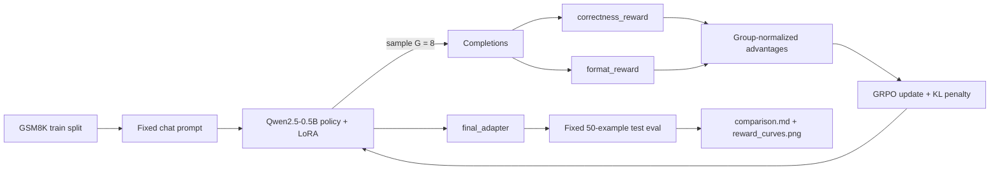
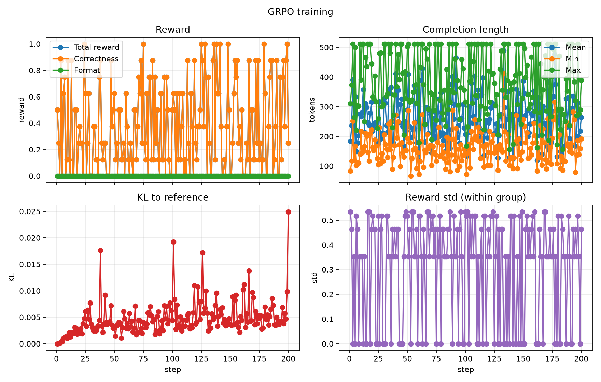

# grpo-small-reasoner

[](https://colab.research.google.com/github/NeelContractor/grpo-small-reasoner/blob/main/notebooks/train_colab.ipynb)
[](https://huggingface.co/NeelContractor/grpo-qwen2.5-0.5b-gsm8k)

GRPO fine-tuning of [`Qwen/Qwen2.5-0.5B-Instruct`](https://huggingface.co/Qwen/Qwen2.5-0.5B-Instruct)
on GSM8K with verifiable rewards. The project includes a deterministic evaluation
harness, pure reward functions, YAML-driven TRL training, LoRA adapters, and a
report generator that compares before/after generations.

**Headline:** on a fixed 50-example GSM8K test subset, a 200-step GRPO run improved
strict answer accuracy from **34.0% to 46.0%** (+12.0 pp). This is directional, not
statistically significant (McNemar exact p = 0.109), and the adapter did **not**
learn the requested output tags. See [Results](#results) and
[Limitations](#limitations) before citing the number.

## Project status

- [x] Phase 1: baseline evaluation
- [x] Phase 2: reward functions
- [x] Phase 3: training
- [x] Phase 4: results
- [x] Phase 5: final documentation

## What is GRPO?

Group Relative Policy Optimization is a reinforcement-learning algorithm for
language models. It is similar in spirit to PPO, but it does not train a separate
value/critic model.

For each prompt, GRPO samples a group of `G` completions from the current policy,
scores each completion with one or more reward functions, and normalizes the scores
within that group:

```text
advantage_i = (reward_i - mean(rewards)) / (std(rewards) + eps)
```

Completions that score above the group average are reinforced; below-average
completions are suppressed. A KL penalty against a frozen reference model keeps the
policy from drifting too far. Because GSM8K answers are verifiable, the main reward
can be an exact numeric match, so no learned reward model is required.

## How this repository works



The training run updates only a LoRA adapter; the base model stays frozen. The
evaluation path loads the base model plus the adapter and uses the same prompt,
subset, seed, and decoding settings as the baseline.

## Repository layout

```text
src/grpo_reasoner/
  data.py        GSM8K loading and deterministic subsets
  prompts.py     Fixed system prompt and chat-template rendering
  extract.py     Numeric answer extraction and matching
  rewards.py     Correctness, format, and optional length rewards
  train.py       YAML-driven GRPO/TRL training entry point
  evaluate.py    Base-model or adapter evaluation entry point
  report.py      Comparison tables, sensitivity checks, and plots
configs/
  train_smoke.yaml   Local MPS/CPU pipeline check
  train_full.yaml    Colab/Kaggle T4 run
notebooks/
  train_colab.ipynb  End-to-end Colab wrapper
results/
  baseline.json, trained.json, comparison.md, reward_curves.png, ...
tests/                 Reward, extraction, config, evaluation, and report tests
```

## Setup

Requires [uv](https://docs.astral.sh/uv/) and Python 3.11+ (tested with 3.12
locally and 3.13 on Colab).

```bash
uv sync --extra dev
uv run pre-commit install
```

Run the checks:

```bash
make test    # 89 tests
make lint
```

Full training needs a CUDA GPU. Evaluation and the smoke test also work on Apple
MPS or CPU, just more slowly.

## Data and prompt

- Dataset: [`openai/gsm8k`](https://huggingface.co/datasets/openai/gsm8k), `main`
  configuration.
- Training: shuffled `train` split, `seed=42`. The full run uses 200 optimizer
  steps, one prompt and eight completions per step.
- Evaluation: a deterministic 50-example subset of the `test` split, `seed=42`.
- Prompt: one fixed system prompt asking the model to reason in
  `<think>...</think>` and put the final numeric answer in `<answer>...</answer>`.

The evaluation harness records the source dataset index for every example, so the
baseline and adapter runs are compared on exactly the same questions.

## Rewards

Each reward is a pure function in `src/grpo_reasoner/rewards.py`:

| Reward | Default weight | Signal |
| --- | ---: | --- |
| `correctness_reward` | 1.0 | 1.0 for an exact numeric match with the gold answer |
| `format_reward` | 0.5 | 1.0 only for exactly one think block and one answer block, with no extra text |
| `length_penalty_reward` | off | Optional capped penalty for completions longer than `target_chars` |

The default objective is therefore `R = R_correct + 0.5 * R_format`.

`correctness_reward` extracts the last `<answer>` block when present, otherwise the
text after `####`, otherwise the last number in the completion. It then compares
numeric values, so `18`, `18.0`, and `1,800` are handled consistently.

## Training

Two YAML configs are provided:

| Config | Purpose |
| --- | --- |
| `configs/train_smoke.yaml` | Laptop pipeline check: 2 steps, 2 generations, 128 tokens |
| `configs/train_full.yaml` | Colab/Kaggle T4: 200 steps, 8 generations per prompt, LoRA |

Main full-run settings:

| Setting | Value |
| --- | --- |
| Base model | `Qwen/Qwen2.5-0.5B-Instruct` |
| Adaptation | LoRA, rank 16, alpha 32, dropout 0.05, all linear projections |
| Optimizer steps | 200 |
| Generations per prompt | 8 |
| Max completion length | 512 tokens |
| Sampling temperature | 1.0 |
| Learning rate | `1e-5` |
| GRPO beta (KL coefficient) | 0.04 |
| Precision | FP16 |
| Seed | 42 |

In TRL, `per_device_train_batch_size` counts completions. With batch size 8 and
`num_generations: 8`, each optimizer step uses one prompt and its eight
completions. To reduce generation memory, set batch size 4 with gradient
accumulation 2.

```bash
# Local pipeline check on Apple MPS/CPU (a few minutes)
make smoke

# Full run on a CUDA GPU
make train
```

`train.py` logs reward, within-group reward std, completion length, and KL to
Weights & Biases when `report_to: wandb`. It writes `resolved_config.json` and
`train_history.json` into the output directory and saves the final adapter to
`outputs/grpo-qwen2.5-0.5b/final_adapter`.

### Colab

The notebook
[`notebooks/train_colab.ipynb`](notebooks/train_colab.ipynb)
clones this repository, installs dependencies into Colab's Python, reads
`WANDB_API_KEY` and `HF_TOKEN` from Colab Secrets, trains, evaluates, builds the
report, and downloads the artifacts. Select **Runtime > Change runtime type > T4
GPU** first. The published run took about **1h45m** on a free T4.

Avoid `make` on Colab: it invokes `uv run`, which creates a separate virtual
environment. Use the system Python instead:

```bash
pip install -q uv
uv pip install --system -e .
python train.py --config configs/train_full.yaml
```

### Publish an adapter

Set `hub.push: true` and `hub.repo_id: your-name/your-adapter` in the YAML config,
then provide `HF_TOKEN`. Only LoRA adapters are uploaded; training refuses to push
when `lora.enabled` is false.

## Evaluation

Evaluate any Hugging Face model or local checkpoint on the fixed subset:

```bash
uv run grpo-eval \
  --model Qwen/Qwen2.5-0.5B-Instruct \
  --limit 50 \
  --output results/baseline.json
```

Add `--adapter PATH_OR_HUB_ID` for a LoRA adapter. The script selects CUDA or MPS
automatically and falls back to CPU; use `--device` and `--dtype` to override.

Evaluation uses greedy decoding, `max_new_tokens=512`, `seed=42`, and the fixed
prompt. The primary metric is strict numeric accuracy: the extracted final answer
must equal the gold answer. The report also computes format adherence and a lenient
upper bound where the gold value appears anywhere in the completion.

Compare two runs:

```bash
uv run grpo-report \
  --baseline results/baseline.json \
  --trained results/trained.json \
  --history results/train_history.json \
  --output results/comparison.md \
  --plot results/reward_curves.png
```

`grpo-report` refuses to compare runs whose base model, seed, subset size, prompt,
or decoding settings differ. It writes:

- strict accuracy and format-adherence tables,
- a lenient extraction-sensitivity table,
- paired improved/regressed counts and an exact McNemar p-value,
- side-by-side sample completions,
- reward, completion-length, KL, and reward-std curves.

For the published run, the report can be regenerated from committed artifacts
without a GPU:

```bash
make report
```

## Results

Full run: `Qwen/Qwen2.5-0.5B-Instruct` + LoRA, 200 GRPO steps on one Colab T4.
The adapter is published at
[`NeelContractor/grpo-qwen2.5-0.5b-gsm8k`](https://huggingface.co/NeelContractor/grpo-qwen2.5-0.5b-gsm8k).

| Stage | Correct | Accuracy | Format adherence |
| --- | ---: | ---: | ---: |
| Baseline (untrained) | 17/50 | 34.0% | 0.0% |
| GRPO adapter | 23/50 | 46.0% | 0.0% |
| Change | +6 | +12.0 pp | +0.0 pp |



### What the numbers mean

- The adapter fixed 8 test examples and broke 2 others. The paired outcomes are
  **8 improved, 2 regressed, 15 both correct, 25 both wrong**.
- McNemar exact two-sided **p = 0.109**. With 50 examples, this is not statistically
  significant at 0.05. Treat the result as directional evidence, not a benchmark
  claim.
- Strict scoring uses the extracted final answer, falling back to the last number.
  A lenient upper-bound check (gold value mentioned anywhere) gives 25/50 (50.0%)
  for the baseline and 27/50 (54.0%) for the adapter. The headline +12.0 pp
  therefore shrinks to **+4.0 pp** when intermediate mentions are allowed. The
  strict metric is sensitive to final-answer formatting.
- Correctness reward averaged 0.40 over the first 10 steps and 0.46 over the last
  20. KL rose from 0.0007 to 0.0063. Mean completion length stayed near 239 tokens.
- **Format adherence stayed at 0%.** No completion in either run used the exact
  `<think>...</think><answer>...</answer>` template. The format reward was zero for
  every training step, so it provided no within-group learning signal; the gain
  comes from the correctness reward on plain reasoning.

### Artifacts

- [`results/comparison.md`](results/comparison.md): full table, sensitivity check,
  paired outcomes, and side-by-side samples.
- [`results/reward_curves.png`](results/reward_curves.png): reward, length, KL, and
  within-group reward std.
- [`results/baseline.json`](results/baseline.json) and
  [`results/trained.json`](results/trained.json): raw generations and predictions.
- [`results/train_history.json`](results/train_history.json) and
  [`results/train_config_resolved.json`](results/train_config_resolved.json): run
  metadata needed to regenerate the report.

### Reproduce the published evaluation

```bash
uv run grpo-eval \
  --model Qwen/Qwen2.5-0.5B-Instruct \
  --adapter NeelContractor/grpo-qwen2.5-0.5b-gsm8k \
  --split test --limit 50 --seed 42 --max-new-tokens 512 \
  --batch-size 1 --temperature 0.0 \
  --output results/trained.json

make report
```

To reproduce training, run the Colab notebook or `python train.py --config
configs/train_full.yaml` on a CUDA GPU with the same seed and config, then evaluate
the local `final_adapter`.

## Limitations

- **Small evaluation.** 50 test examples, one training seed, one run. The +12 pp
  result is not statistically significant, and no multi-seed variance was measured.
- **Format reward failed.** The exact-template reward was too sparse: no sampled
  completion matched it, so every group had zero format variance. A partial-credit
  format reward or an SFT warm start would likely be needed.
- **Metric ambiguity.** Strict extraction can miss a correct answer that ends with
  a distractor number; lenient matching can count an intermediate mention. The
  lenient upper bound is only +4 pp, so the measured gain is sensitive to
  final-answer formatting.
- **Final-answer reward only.** `correctness_reward` rewards the right number, not a
  valid reasoning process. A lucky guess or an invalid derivation with the right
  final number is scored correct.
- **Limited training.** 200 optimizer steps on a 0.5B model with LoRA, not a full
  GSM8K training recipe. The adapter is not a general-purpose reasoning model.
- **Hardware difference.** The baseline was generated on Apple MPS and the adapter
  evaluation on a CUDA T4, both in FP16. The 50 questions are identical, but small
  hardware-dependent numeric differences are possible.
- **No full-test claim.** These numbers are for a fixed 50-example subset, not the
  full GSM8K test set.

## Future work

- Add partial-credit format shaping or an SFT warm start so the requested tags are
  actually learned.
- Evaluate on the full GSM8K test set and multiple seeds; report confidence
  intervals and paired tests.
- Improve answer extraction or require an explicit answer tag before scoring.
- Try a process reward, a larger Qwen model, longer training, and 4-bit loading.
- Track format adherence as a first-class training metric rather than only in the
  final report.

## Troubleshooting

### Incompatible torchao on Colab

PEFT can fail during LoRA injection with:

```text
ImportError: Found an incompatible version of torchao. Found version 0.10.0,
but only versions above 0.16.0 are supported
```

Torchao is not used by this project. Remove Colab's old copy and rerun:

```bash
pip uninstall -y torchao
```

### FP16 on Apple Silicon

The smoke config uses FP32 because this project's training path requires CUDA for
FP16/BF16. Keep `fp16: false` and `bf16: false` when training locally without CUDA.

### Weights & Biases

Set `WANDB_API_KEY` before training, or run `wandb login`. Set
`report_to: none` to disable logging.

### Out of memory on a T4

Use `per_device_train_batch_size: 4` with `gradient_accumulation_steps: 2`, or
reduce `max_completion_length`. Keep the product divisible by `num_generations`.

## Acknowledgements

Built with [TRL](https://github.com/huggingface/trl),
[Transformers](https://github.com/huggingface/transformers),
[PEFT](https://github.com/huggingface/peft),
[GSM8K](https://huggingface.co/datasets/openai/gsm8k), and
[Qwen2.5](https://huggingface.co/Qwen/Qwen2.5-0.5B-Instruct).
